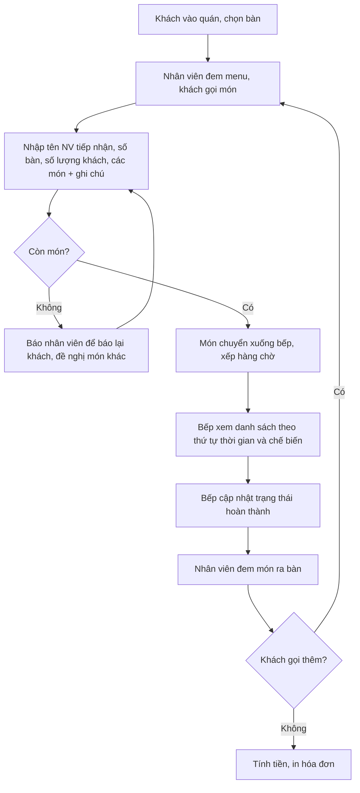

# Business Requirements

> Nguồn: `docs/10_Quan-ly-quan-an.pdf` (đề bài "Lập trình ứng dụng quản lý 1" — Hệ thống quản lý quán ăn) + luồng nghiệp vụ đã thống nhất trước đó.

## 1. Mục tiêu đồ án

| # | Mục tiêu | Diễn giải |
|---|----------|-----------|
| MT-1 | Báo cáo doanh thu nhanh và dễ dàng | Chủ quán tự lập được báo cáo doanh thu theo tháng/quý/năm mà không phải tổng hợp thủ công. |
| MT-2 | Hỗ trợ bán hàng | Số hóa toàn bộ quy trình từ lúc khách vào quán đến khi in hóa đơn: chọn bàn → gọi món → bếp chế biến → phục vụ → thanh toán. |
| MT-3 | Quản lý nhân viên | Quản lý hồ sơ, ca làm việc, lịch làm việc theo tháng, chấm công, tính lương theo số ca, xử lý nghỉ việc. |

## 2. Phạm vi

**Trong phạm vi (bắt buộc):**
- Quản lý bàn, thực đơn, gọi món, xử lý món tại bếp, thanh toán và in hóa đơn.
- Quản lý hồ sơ nhân viên, ca làm việc, lịch làm việc theo tháng, chấm công, duyệt chấm công, tính lương theo số ca.
- Báo cáo doanh thu và các thống kê phục vụ chủ quán.
- Phân quyền người dùng theo loại người dùng.
- Tài liệu: phân tích, thiết kế, hướng dẫn sử dụng; source code; mô tả phần mềm cần thiết để chạy.

**Tùy chọn (không bắt buộc):**
- Phân quyền chi tiết đến từng chức năng (thêm/xóa chức năng cho mỗi loại người dùng).
- Backup/Restore dữ liệu.

**Ngoài phạm vi (đề xuất loại bỏ để giữ đồ án gọn):**
- Đặt bàn trực tuyến, giao hàng, tích điểm, thanh toán qua cổng trực tuyến, quản lý kho nguyên vật liệu.

## 3. Actors

| Actor | Loại | Phạm vi sử dụng chính |
|-------|------|----------------------|
| Khách hàng | Actor phụ (không thao tác hệ thống) | Chọn bàn, gọi món, yêu cầu hủy món, chuyển bàn, thanh toán. Mọi thao tác đều do nhân viên nhập hộ. |
| Nhân viên phục vụ | Actor chính | Xem lịch làm việc của mình, chấm công, đổi mật khẩu, xem trạng thái bàn, đặt/thêm/đổi món, gộp bàn, tính tiền và in hóa đơn. |
| Nhà bếp (kèm pha chế) | Actor chính | Xem danh sách món đang chờ theo thứ tự thời gian, cập nhật trạng thái món đã hoàn thành. |
| Quản lý | Actor chính | Xem lịch làm việc chung và lịch của từng nhân viên, duyệt chấm công, thực hiện các chức năng của nhân viên phục vụ nhưng gắn với chính mình (có thêm giá trị đầu vào là nhân viên phục vụ). |
| Chủ quán | Actor chính, quyền cao nhất | Cấu hình ca, quản lý nhân viên, tổ chức bàn, quản lý thực đơn, xếp lịch, duyệt số ca, toàn bộ báo cáo, phân quyền người dùng, backup/restore. |

**Ghi chú:** "vị trí dự tuyển" của nhân viên gồm *nhân viên phục vụ, nhân viên pha chế, nhân viên quản lý, nhân viên tiếp tân* — đây là **thuộc tính hồ sơ nhân viên**, không đồng nhất với **vai trò đăng nhập** của hệ thống.

## 4. Quy trình nghiệp vụ 1 — Từ khi khách vào quán đến khi ra về

**Quy tắc nghiệp vụ của quy trình 1:**

| Mã | Quy tắc |
|----|---------|
| BR-01 | Khách có thể gọi món nhiều lần trong cùng một lượt ngồi; mỗi lần gọi là một lần bổ sung vào cùng hóa đơn của bàn. |
| BR-02 | Khách được hủy món **chỉ khi món chưa được thực hiện** (trạng thái đang chờ); món đã chế biến không được hủy. |
| BR-03 | Khách có thể chuyển bàn; hóa đơn đi theo bàn mới, lịch sử chuyển bàn phải lưu lại. |
| BR-04 | Khách có thể ghép bàn khi tính tiền: nhiều bàn được cộng chung vào một hóa đơn. |
| BR-05 | Món hết phải được đánh dấu để nhân viên báo lại khách, không cho gọi món đã hết. |
| BR-06 | Bếp xử lý món theo **thứ tự thời gian đặt** (FIFO). |
| BR-07 | Mỗi hóa đơn phải ghi nhận nhân viên tiếp nhận và số lượng khách (phục vụ thống kê). |
| BR-08 | Khi tính tiền, hệ thống phải in được hóa đơn cho khách. |
| BR-09 | Trạng thái bàn hiển thị 4 giá trị: **trống / có khách / đang đợi món / món đã xong**. |

## 5. Quy trình nghiệp vụ 2 — Từ khi nhận nhân viên đến khi nhân viên nghỉ việc

**Bước 1 — Tiếp nhận nhân viên.** Hồ sơ gồm:
- Họ tên, giới tính, ngày sinh
- Vị trí dự tuyển: nhân viên phục vụ / nhân viên pha chế / nhân viên quản lý / nhân viên tiếp tân
- Điện thoại, địa chỉ, CMND
- Thời gian bắt đầu làm việc
- Trình độ vi tính: Word, Excel, Cài phần mềm, Khác *(danh sách có thể thay đổi)*
- Thời gian có thể làm việc: ngày chia 3 ca (8g–13g, 12g–17g, 17g–22g) *(danh sách ca và thời gian có thể thay đổi)*
- Dụng cụ/trang phục nhận từ quán

**Bước 2 — Xếp lịch.** Nhân viên được gán vào một hoặc nhiều ca trong số các ca có thể làm. Lịch lưu theo từng tháng; mỗi ngày 3 ca, mỗi tuần 7 ngày (số ca và thời gian trong ngày có thể thay đổi).

**Bước 3 — Chấm công.** Nhân viên chấm công bắt đầu làm / kết thúc làm; quản lý duyệt chấm công.

**Bước 4 — Tính lương.** Lương phụ thuộc vào **tổng số ca làm việc trong tháng**.

**Bước 5 — Nghỉ việc.** Đổi trạng thái nhân viên, xóa lịch làm việc, ghi nhận trả trang phục/dụng cụ.

**Quy tắc nghiệp vụ của quy trình 2:**

| Mã | Quy tắc |
|----|---------|
| BR-10 | Danh mục "trình độ vi tính" và "ca làm việc" là **dữ liệu cấu hình**, phải thêm/sửa/xóa được, không hard-code. |
| BR-11 | Một nhân viên chỉ được xếp vào ca nằm trong danh sách ca mà nhân viên đó có thể làm. |
| BR-12 | Không xếp trùng một nhân viên vào hai ca trùng khung giờ trong cùng một ngày. |
| BR-13 | Lịch làm việc lưu theo tháng; mỗi ngày 2–3 ca, mỗi tuần 7 ngày. |
| BR-14 | Lương tháng = tổng số ca làm việc trong tháng × đơn giá ca (đơn giá theo vị trí/nhân viên). |
| BR-15 | Chỉ ca đã được quản lý **duyệt chấm công** mới được tính vào lương. |
| BR-16 | Nhân viên nghỉ việc: chuyển trạng thái "Đã nghỉ", xóa khỏi lịch các tháng sau, ghi nhận trả dụng cụ/trang phục. |

## 6. Yêu cầu chức năng theo actor (bắt buộc)

**Nhân viên phục vụ**
- Xem lịch làm việc của mình theo tuần
- Chấm công: bắt đầu làm, kết thúc làm
- Đổi mật khẩu
- Xem danh sách bàn kèm trạng thái (trống, có khách, đang đợi món, món đã xong)
- Đặt món cho một bàn
- Thêm món cho một bàn
- Đổi món cho một bàn
- Gộp bàn (hai nhóm khách tính chung một hóa đơn)
- Tính tiền: cộng tiền và in hóa đơn

**Nhà bếp**
- Xem danh sách món đang được đặt theo thứ tự thời gian
- Thông báo món đã hoàn thành

**Quản lý**
- Xem lịch làm việc chung (tất cả nhân viên)
- Xem lịch làm việc riêng của một nhân viên
- Duyệt chấm công
- Các chức năng của nhân viên phục vụ, có thêm tham số "nhân viên phục vụ" đầu vào

**Chủ quán**
- Cấu hình ca: 2 ca cố định mỗi ngày (9h–16h, 16h–22h)
- Thêm/Sửa/Xóa nhân viên
- Duyệt số ca làm việc trong tháng
- Tổ chức bàn ghế: gán số thứ tự, số người tối đa
- Khởi tạo/chỉnh sửa món ăn/nước uống
- Xem/chỉnh sửa lịch làm việc tuần của **tất cả** nhân viên (7 ngày/tuần, 2 ca/ngày): xem ca trống, số nhân viên mỗi ca, thêm/xóa nhân viên khỏi ca
- Xem/chỉnh sửa lịch làm việc tuần của **một** nhân viên: xem ca trống/ca làm việc, thay đổi trạng thái ca
- Lập báo cáo: doanh thu tháng/quý/năm; số lượng khách theo ca trong tháng/quý/năm; số lượng khách một nhân viên phục vụ trong tuần; số lượng khách của bàn trong tháng/quý/năm; số lượng bán của món trong tháng/quý/năm; số ca nhân viên
- Phân quyền người dùng: tạo/sửa/xóa loại người dùng, thêm/xóa chức năng cho mỗi loại người dùng *(tùy chọn)*
- Backup/Restore dữ liệu *(tùy chọn)*

## 7. Yêu cầu phi chức năng

| Mã | Yêu cầu |
|----|---------|
| NFR-01 | Giao diện tiếng Việt, thao tác nhanh tại quầy/bàn (thao tác gọi món không quá vài giây). |
| NFR-02 | Phân quyền theo loại người dùng; người dùng chỉ thấy chức năng được cấp. |
| NFR-03 | Mật khẩu lưu dạng hash; bắt buộc đăng nhập trước khi dùng chức năng. |
| NFR-04 | Dữ liệu báo cáo phải khớp với dữ liệu hóa đơn/thanh toán đã phát sinh. |
| NFR-05 | In được hóa đơn trực tiếp từ màn hình tính tiền. |
| NFR-06 | Công nghệ: ASP.NET Core MVC (.NET 10), Entity Framework Core, SQL Server 2022 (chạy Docker), Visual Studio 2022. *(Đề/dự kiến ban đầu là .NET 9 — xem ghi chú phiên bản ở `07_TechnologyStack.md`.)* |
| NFR-07 | Kiến trúc: Clean Architecture, DI, Repository Pattern, Service Layer, DTO, Async/Await; không đặt business logic/SQL trong Controller, không truy cập DbContext từ View. |

## 8. Điểm mâu thuẫn / cần làm rõ với giảng viên

| # | Vấn đề | Đề xuất xử lý |
|---|--------|---------------|
| 1 | Đề bài nêu **3 ca** (8h–13h, 12h–17h, 17h–22h) ở phần nhân viên nhưng phần chủ quán lại nêu **2 ca cố định** (9h–16h, 16h–22h). Hai khung giờ còn chồng lấn (12h–13h). | Đưa ca vào **bảng cấu hình** (tên ca, giờ bắt đầu, giờ kết thúc, trạng thái); dữ liệu mẫu dùng 2 ca 9h–16h / 16h–22h. Chức năng không phụ thuộc số ca. |
| 2 | "Nhân viên pha chế" là vị trí dự tuyển hay là bộ phận bếp riêng? | Gộp vào actor Nhà bếp, phân biệt bằng vị trí nhân viên; hàng đợi món có thể lọc theo loại món (đồ uống → quầy pha chế). |
| 3 | Quản lý và Chủ quán có nhiều quyền trùng nhau. | Chủ quán = toàn quyền + cấu hình + báo cáo; Quản lý = nghiệp vụ vận hành + duyệt chấm công, không cấu hình hệ thống. |
| 4 | "Đổi món" khác "Hủy món" ở điểm nào? | Đổi món = hủy món cũ (chỉ khi chưa thực hiện) + thêm món mới, lưu lý do; Hủy món = bỏ món không thay thế. |
| 5 | Ghép bàn "khi tính tiền" — có gộp luôn hóa đơn hay chỉ in chung? | Gộp hóa đơn của các bàn thành một hóa đơn thanh toán, lưu liên kết hóa đơn–bàn để báo cáo theo bàn vẫn chính xác. |
| 6 | "Số lượng khách theo ca" — ca của hóa đơn xác định thế nào? | Ghi nhận ca tại thời điểm mở bàn (hoặc thời điểm thanh toán) vào hóa đơn; thống nhất một mốc và ghi rõ trong tài liệu. |
| 7 | Lương tính theo ca, nhưng ca có thể thay đổi thời lượng. | Thêm đơn giá ca theo cấu hình/vị trí để tránh sai lệch khi thời lượng ca thay đổi. |
| 8 | Tài liệu nộp bài có bảng "Tên lớp / Tên thuộc tính / Kiểu dữ liệu" nhưng bỏ trống. | Bảng này phải được điền đầy đủ trong tài liệu thiết kế (xem `06_DatabaseRequirements.md`). |

## 9. Yêu cầu nộp bài (theo đề)

| # | Hạng mục | Nội dung |
|---|----------|----------|
| 1 | Documents | Tài liệu mô tả phần mềm: phân tích, thiết kế, hướng dẫn sử dụng. |
| 2 | Sources | Toàn bộ mã nguồn. |
| 3 | Phần mềm cần thiết | Danh sách phần mềm/môi trường để chạy chương trình (VS 2022, .NET 9 SDK, Docker + SQL Server 2022 image). |
| 4 | Bảng thiết kế lớp | Bảng Tên lớp / Tên thuộc tính / Kiểu dữ liệu (đề có mẫu, cần điền đủ). |

> **Lưu ý về "yêu cầu chấm điểm":** file PDF **không có thang điểm/rubric** chấm. Các tiêu chí chấm được suy ra từ (a) danh sách chức năng bắt buộc, (b) các ghi chú nghiệp vụ (hủy món, chuyển bàn, ghép bàn, gọi nhiều lần), (c) danh sách tài liệu phải nộp, (d) bảng thiết kế lớp. Nếu giảng viên có rubric riêng, cần bổ sung vào mục này.
