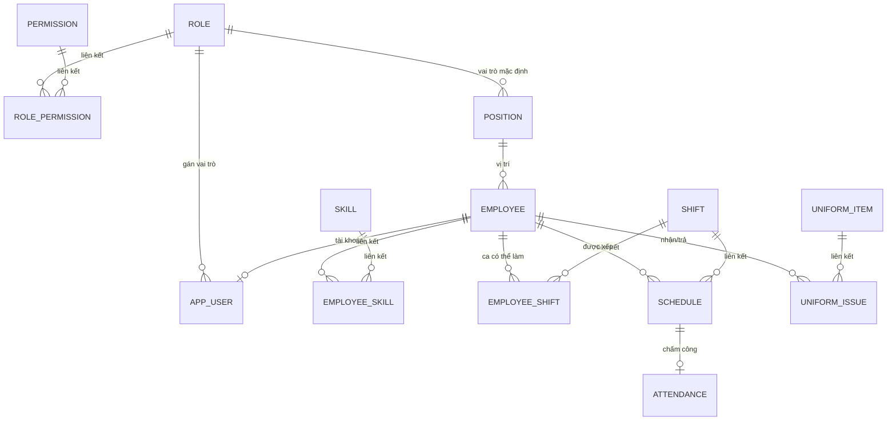
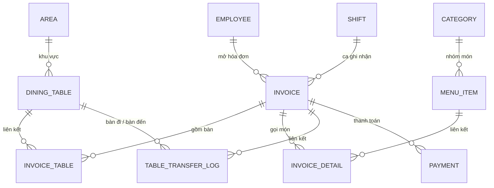

# Database Schema Design — SQL Server (Docker)

> Tài liệu thiết kế CSDL hoàn chỉnh cho **Restaurant Management System**, dựa trên bộ tài liệu `01`–`09` và đề bài `10_Quan-ly-quan-an.pdf`.
> Phạm vi: **thiết kế** (ERD, danh sách bảng, quan hệ, đặc tả cột/khóa/chỉ mục, triển khai Docker). **Không sinh mã** — script `CREATE TABLE` sẽ được tạo ở bước riêng khi được yêu cầu.

## 1. Nguyên tắc thiết kế

| # | Nguyên tắc | Áp dụng |
|---|-----------|---------|
| 1 | Chuẩn hóa **3NF** | Tách bảng tra cứu (Role, Position, Skill, Shift, Area, Category), tách quan hệ N-N, loại bỏ thuộc tính suy diễn khỏi bảng gốc. |
| 2 | **PK/FK** rõ ràng | Mọi bảng có khóa chính; mọi quan hệ có FK; đặt tên theo mẫu `FK_<Child>_<Parent>`. |
| 3 | **Audit fields** | 7 cột audit chuẩn trên mọi bảng nghiệp vụ (mục 5.5) + bảng `AuditLog` cho thay đổi dữ liệu nhạy cảm. |
| 4 | **Soft delete** | `IsDeleted` + `DeletedAt`; không xóa cứng dữ liệu đã phát sinh báo cáo. |
| 5 | **Snapshot có kiểm soát** | Giá món, ca làm việc được chụp lại tại thời điểm phát sinh giao dịch để báo cáo lịch sử luôn đúng. |
| 6 | **Không lưu dữ liệu suy diễn** | Tổng tiền hóa đơn, trạng thái bàn, tồn dụng cụ → tính bằng view. |
| 7 | **Đồng bộ EF Core** | Kiểu dữ liệu và khóa ngoại thân thiện với EF Core 9 + SQL Server 2022. |
| 8 | **Tiếng Việt** | Collation `Vietnamese_CI_AS`, `nvarchar` cho toàn bộ chuỗi hiển thị. |

**Quy ước đặt tên:** bảng/cột PascalCase số ít (`Invoice`, `InvoiceDetail`); PK là `Id`; FK là `<Entity>Id`; unique key `UQ_...`; check `CK_...`; index `IX_...`.

**Bảng `User` được đổi thành `AppUser`** vì `USER` là từ khóa hệ thống của SQL Server.

## 2. ERD

### 2.1 Nhóm Nhân sự & Bảo mật



### 2.2 Nhóm Bán hàng



> `TABLE_TRANSFER_LOG` tham chiếu `DINING_TABLE` hai lần (`FromTableId`, `ToTableId`) — Mermaid chỉ vẽ được một nhánh, chi tiết ở mục 4.

### 2.3 Sơ đồ quan hệ tổng quát (dạng khối)

```
[Role]──<[AppUser]>──[Employee]──<[Schedule]>──[Attendance]
   │                     │  │
   │                     │  └──<[EmployeeSkill]>──[Skill]
   │                     │  └──<[EmployeeShift]>──[Shift]──<[Schedule]
   │                     └──<[UniformIssue]>──[UniformItem]
   └──<[RolePermission]>──[Permission]

[Position]──<[Employee]
[Area]──<[DiningTable]──<[InvoiceTable]>──[Invoice]──<[InvoiceDetail]>──[MenuItem]──[Category]
                                              │
                                              ├──<[Payment]
                                              └──<[TableTransferLog]
[Shift]──<[Invoice]                          [SystemParameter]  [AuditLog]
```

## 3. Danh sách bảng

| # | Bảng | Nhóm | Mục đích | Bắt buộc |
|---|------|------|----------|:--------:|
| 1 | `Role` | Bảo mật | Vai trò: Chủ quán, Quản lý, Thu ngân, Phục vụ, Bếp, Admin | ✔ |
| 2 | `AppUser` | Bảo mật | Tài khoản đăng nhập, gắn nhân viên | ✔ |
| 3 | `Permission` | Bảo mật | Danh mục chức năng được phân quyền | ○ |
| 4 | `RolePermission` | Bảo mật | N-N vai trò ↔ chức năng | ○ |
| 5 | `SystemParameter` | Hệ thống | Tham số cấu hình (số ca/ngày, đơn giá mặc định…) | ✔ |
| 6 | `AuditLog` | Hệ thống | Nhật ký thay đổi dữ liệu | ✔ |
| 7 | `Position` | Nhân sự | Vị trí công việc + đơn giá ca mặc định | ✔ |
| 8 | `Employee` | Nhân sự | Hồ sơ nhân viên | ✔ |
| 9 | `Skill` | Nhân sự | Trình độ vi tính (Word, Excel, Cài phần mềm, Khác) | ✔ |
| 10 | `EmployeeSkill` | Nhân sự | N-N nhân viên ↔ trình độ | ✔ |
| 11 | `Shift` | Nhân sự | Ca làm việc (cấu hình được) | ✔ |
| 12 | `EmployeeShift` | Nhân sự | N-N nhân viên ↔ ca **có thể** làm | ✔ |
| 13 | `Schedule` | Nhân sự | Lịch làm việc theo ngày/tháng | ✔ |
| 14 | `Attendance` | Nhân sự | Chấm công vào/ra + duyệt | ✔ |
| 15 | `UniformItem` | Nhân sự | Danh mục dụng cụ/trang phục | ✔ |
| 16 | `UniformIssue` | Nhân sự | Cấp phát và trả dụng cụ | ✔ |
| 17 | `Area` | Bán hàng | Khu vực/tầng của bàn | ○ |
| 18 | `DiningTable` | Bán hàng | Bàn: số bàn, số người tối đa | ✔ |
| 19 | `Category` | Bán hàng | Nhóm món | ✔ |
| 20 | `MenuItem` | Bán hàng | Món ăn/nước uống, giá, còn/hết | ✔ |
| 21 | `Invoice` | Bán hàng | Hóa đơn/lượt khách | ✔ |
| 22 | `InvoiceTable` | Bán hàng | Hóa đơn ↔ bàn (ghép bàn, chuyển bàn) | ✔ |
| 23 | `InvoiceDetail` | Bán hàng | Dòng món trong hóa đơn | ✔ |
| 24 | `TableTransferLog` | Bán hàng | Lịch sử chuyển bàn | ✔ |
| 25 | `Payment` | Bán hàng | Thanh toán hóa đơn | ✔ |

**Tổng: 25 bảng** (22 bắt buộc, 3 tùy chọn: `Permission`, `RolePermission`, `Area`).

## 4. Danh sách quan hệ

| # | Quan hệ | Cardinality | FK | Hành vi xóa | Ghi chú |
|---|---------|-------------|----|-------------|---------|
| R1 | `Role` → `AppUser` | 1 : N | `AppUser.RoleId` | NO ACTION | Không xóa vai trò đang dùng |
| R2 | `Role` → `RolePermission` | 1 : N | `RolePermission.RoleId` | NO ACTION | |
| R3 | `Permission` → `RolePermission` | 1 : N | `RolePermission.PermissionId` | NO ACTION | |
| R4 | `Role` → `Position` | 1 : N | `Position.DefaultRoleId` (NULL) | SET NULL | Vai trò mặc định theo vị trí |
| R5 | `Position` → `Employee` | 1 : N | `Employee.PositionId` | NO ACTION | |
| R6 | `Employee` → `AppUser` | 1 : 0..1 | `AppUser.EmployeeId` (NULL, UNIQUE filtered) | SET NULL | Một nhân viên một tài khoản |
| R7 | `Employee` → `EmployeeSkill` | 1 : N | `EmployeeSkill.EmployeeId` | NO ACTION | |
| R8 | `Skill` → `EmployeeSkill` | 1 : N | `EmployeeSkill.SkillId` | NO ACTION | |
| R9 | `Employee` → `EmployeeShift` | 1 : N | `EmployeeShift.EmployeeId` | NO ACTION | |
| R10 | `Shift` → `EmployeeShift` | 1 : N | `EmployeeShift.ShiftId` | NO ACTION | |
| R11 | `Employee` → `Schedule` | 1 : N | `Schedule.EmployeeId` | NO ACTION | |
| R12 | `Shift` → `Schedule` | 1 : N | `Schedule.ShiftId` | NO ACTION | |
| R13 | `Employee` → `Schedule.ApprovedBy` | 1 : N | `Schedule.ApprovedBy` (NULL) | NO ACTION | Người duyệt số ca |
| R14 | `Schedule` → `Attendance` | 1 : 0..1 | `Attendance.ScheduleId` (UNIQUE) | NO ACTION | Mỗi ca tối đa 1 bản ghi chấm công |
| R15 | `Employee` → `Attendance.ApprovedBy` | 1 : N | `Attendance.ApprovedBy` (NULL) | NO ACTION | Quản lý duyệt |
| R16 | `Employee` → `UniformIssue` | 1 : N | `UniformIssue.EmployeeId` | NO ACTION | |
| R17 | `UniformItem` → `UniformIssue` | 1 : N | `UniformIssue.UniformItemId` | NO ACTION | |
| R18 | `Area` → `DiningTable` | 1 : N | `DiningTable.AreaId` (NULL) | SET NULL | |
| R19 | `Category` → `MenuItem` | 1 : N | `MenuItem.CategoryId` | NO ACTION | |
| R20 | `Employee` → `Invoice` | 1 : N | `Invoice.OpenedByEmployeeId` | NO ACTION | Nhân viên tiếp nhận |
| R21 | `Shift` → `Invoice` | 1 : N | `Invoice.ShiftId` (NULL) | NO ACTION | Ca ghi nhận (snapshot) |
| R22 | `Invoice` → `InvoiceTable` | 1 : N | `InvoiceTable.InvoiceId` | NO ACTION | |
| R23 | `DiningTable` → `InvoiceTable` | 1 : N | `InvoiceTable.TableId` | NO ACTION | |
| R24 | `Invoice` → `InvoiceDetail` | 1 : N | `InvoiceDetail.InvoiceId` | NO ACTION | |
| R25 | `MenuItem` → `InvoiceDetail` | 1 : N | `InvoiceDetail.MenuItemId` | NO ACTION | |
| R26 | `Employee` → `InvoiceDetail.CancelledBy` | 1 : N | `InvoiceDetail.CancelledBy` (NULL) | NO ACTION | Người hủy món |
| R27 | `Invoice` → `TableTransferLog` | 1 : N | `TableTransferLog.InvoiceId` | NO ACTION | |
| R28 | `DiningTable` → `TableTransferLog` | 1 : N | `TableTransferLog.FromTableId`, `ToTableId` | NO ACTION | 2 FK cùng trỏ `DiningTable` |
| R29 | `Employee` → `TableTransferLog.MovedByEmployeeId` | 1 : N | `TableTransferLog.MovedByEmployeeId` | NO ACTION | |
| R30 | `Invoice` → `Payment` | 1 : 0..1 | `Payment.InvoiceId` (UNIQUE) | NO ACTION | Mức cơ bản: 1 lần thanh toán |
| R31 | `Employee` → `Payment.PaidByEmployeeId` | 1 : N | `Payment.PaidByEmployeeId` | NO ACTION | Thu ngân |
| R32 | `AppUser` → audit columns | 1 : N | `CreatedBy`, `UpdatedBy` trên các bảng | NO ACTION | Không cascade |

> **Toàn bộ FK dùng `NO ACTION`** (không cascade) để tránh xóa dây chuyền làm mất dữ liệu báo cáo; việc "xóa" được thực hiện bằng `IsDeleted`/`Status`.

## 5. Đặc tả bảng (SQL Server)

### 5.1 Nhóm bảo mật

#### 5.1.1 `Role`

| Cột | Kiểu | Null | Khóa / Ràng buộc | Ghi chú |
|-----|------|:----:|------------------|---------|
| Id | int IDENTITY | ✖ | PK_`Role` | |
| Code | varchar(20) | ✖ | UQ_`Role`_Code | `ADMIN`, `OWNER`, `MANAGER`, `CASHIER`, `WAITER`, `KITCHEN` |
| Name | nvarchar(50) | ✖ | | Chủ quán, Quản lý, Thu ngân, Phục vụ, Bếp, Admin |
| Description | nvarchar(255) | ✔ | | |
| IsSystem | bit | ✖ | DF `0` | Vai trò hệ thống không cho xóa |
| *audit* | | | | Xem 5.5 |

#### 5.1.2 `AppUser`

| Cột | Kiểu | Null | Khóa / Ràng buộc | Ghi chú |
|-----|------|:----:|------------------|---------|
| Id | int IDENTITY | ✖ | PK | |
| Username | nvarchar(50) | ✖ | UQ_`AppUser`_Username | |
| PasswordHash | nvarchar(255) | ✖ | | Hash do ASP.NET Identity sinh |
| RoleId | int | ✖ | FK_`AppUser`_`Role` | |
| EmployeeId | int | ✔ | FK_`AppUser`_`Employee`; UQ filtered `WHERE EmployeeId IS NOT NULL` | 1-1 với nhân viên |
| IsActive | bit | ✖ | DF `1` | Khóa khi nghỉ việc |
| LastLoginAt | datetime2(0) | ✔ | | |
| *audit* | | | | |

#### 5.1.3 `Permission` *(tùy chọn)*

| Cột | Kiểu | Null | Khóa / Ràng buộc | Ghi chú |
|-----|------|:----:|------------------|---------|
| Id | int IDENTITY | ✖ | PK | |
| Code | varchar(100) | ✖ | UQ | VD `ORDER.CANCEL_ITEM` |
| Name | nvarchar(150) | ✖ | | |
| ModuleName | nvarchar(50) | ✔ | | Module 1–13 trong `05_SystemModules.md` |
| *audit* | | | | |

#### 5.1.4 `RolePermission` *(tùy chọn)*

| Cột | Kiểu | Null | Khóa / Ràng buộc | Ghi chú |
|-----|------|:----:|------------------|---------|
| RoleId | int | ✖ | PK (RoleId, PermissionId); FK | |
| PermissionId | int | ✖ | PK (RoleId, PermissionId); FK | |
| CreatedAt / CreatedBy | datetime2 / int | ✖/✔ | | Bảng nối chỉ cần audit tạo |

### 5.2 Nhóm nhân sự

#### 5.2.1 `Position`

| Cột | Kiểu | Null | Khóa / Ràng buộc | Ghi chú |
|-----|------|:----:|------------------|---------|
| Id | int IDENTITY | ✖ | PK | |
| Code | varchar(20) | ✖ | UQ | `WAITER`, `BARTENDER`, `MANAGER`, `RECEPTION` |
| Name | nvarchar(50) | ✖ | UQ | Nhân viên phục vụ / pha chế / quản lý / tiếp tân |
| DefaultRoleId | int | ✔ | FK_`Position`_`Role` | Vai trò đăng nhập mặc định |
| DefaultShiftRate | decimal(18,2) | ✖ | DF `0`; CK ≥ 0 | Đơn giá ca mặc định |
| IsActive | bit | ✖ | DF `1` | |
| *audit* | | | | |

#### 5.2.2 `Employee`

| Cột | Kiểu | Null | Khóa / Ràng buộc | Ghi chú |
|-----|------|:----:|------------------|---------|
| Id | int IDENTITY | ✖ | PK | |
| EmployeeCode | varchar(20) | ✖ | UQ | Mã nhân viên |
| FullName | nvarchar(100) | ✖ | | Họ tên |
| Gender | tinyint | ✔ | CK IN (0,1,2) | 0 Nữ, 1 Nam, 2 Khác |
| DateOfBirth | date | ✔ | CK ≤ hôm nay | Ngày sinh |
| PositionId | int | ✖ | FK_`Employee`_`Position` | Vị trí dự tuyển |
| Phone | nvarchar(20) | ✔ | | Điện thoại |
| Address | nvarchar(255) | ✔ | | Địa chỉ |
| IdentityNumber | varchar(20) | ✖ | UQ | CMND/CCCD |
| StartDate | date | ✖ | | Thời gian bắt đầu làm việc |
| EndDate | date | ✔ | CK ≥ StartDate | Ngày nghỉ việc |
| ShiftRate | decimal(18,2) | ✔ | CK ≥ 0 | Ghi đè đơn giá ca của vị trí (NULL = dùng mặc định) |
| Status | tinyint | ✖ | CK IN (0,1,2); DF `0` | 0 Đang làm, 1 Tạm nghỉ, 2 Đã nghỉ |
| Note | nvarchar(255) | ✔ | | |
| *audit* | | | | |

**Lưu ý 3NF:** đơn giá ca thuộc `Position`; `Employee.ShiftRate` chỉ là **ngoại lệ có kiểm soát** cho trường hợp thỏa thuận riêng.

#### 5.2.3 `Skill`

| Cột | Kiểu | Null | Khóa / Ràng buộc | Ghi chú |
|-----|------|:----:|------------------|---------|
| Id | int IDENTITY | ✖ | PK | |
| Name | nvarchar(50) | ✖ | UQ | Word, Excel, Cài phần mềm, Khác |
| DisplayOrder | int | ✖ | DF `0` | Danh sách có thể thay đổi |
| IsActive | bit | ✖ | DF `1` | |
| *audit* | | | | |

#### 5.2.4 `EmployeeSkill`

| Cột | Kiểu | Null | Khóa / Ràng buộc |
|-----|------|:----:|------------------|
| EmployeeId | int | ✖ | PK (EmployeeId, SkillId); FK |
| SkillId | int | ✖ | PK (EmployeeId, SkillId); FK |
| CreatedAt / CreatedBy | datetime2 / int | ✖/✔ | |

#### 5.2.5 `Shift`

| Cột | Kiểu | Null | Khóa / Ràng buộc | Ghi chú |
|-----|------|:----:|------------------|---------|
| Id | int IDENTITY | ✖ | PK | |
| Name | nvarchar(50) | ✖ | UQ | Ca sáng / Ca chiều |
| StartTime | time(0) | ✖ | CK `StartTime < EndTime` | Không hỗ trợ ca qua đêm |
| EndTime | time(0) | ✖ | | |
| IsActive | bit | ✖ | DF `1` | Ngừng dùng thay vì xóa |
| *audit* | | | | |

> Ca là **dữ liệu cấu hình**: 2 ca (09:00–16:00, 16:00–22:00) hoặc 3 ca (08:00–13:00, 12:00–17:00, 17:00–22:00) đều nhập được, không hard-code.

#### 5.2.6 `EmployeeShift`

| Cột | Kiểu | Null | Khóa / Ràng buộc |
|-----|------|:----:|------------------|
| EmployeeId | int | ✖ | PK (EmployeeId, ShiftId); FK |
| ShiftId | int | ✖ | PK (EmployeeId, ShiftId); FK |
| CreatedAt / CreatedBy | datetime2 / int | ✖/✔ | |

#### 5.2.7 `Schedule`

| Cột | Kiểu | Null | Khóa / Ràng buộc | Ghi chú |
|-----|------|:----:|------------------|---------|
| Id | int IDENTITY | ✖ | PK | |
| EmployeeId | int | ✖ | FK | |
| ShiftId | int | ✖ | FK | |
| WorkDate | date | ✖ | | Lịch theo tháng, kiểm tra theo ngày |
| Status | tinyint | ✖ | CK IN (0,1,2); DF `0` | 0 Chưa duyệt, 1 Đã duyệt, 2 Vắng |
| ApprovedBy | int | ✔ | FK_`Schedule`_`Employee` | Người duyệt số ca |
| ApprovedAt | datetime2(0) | ✔ | | |
| Note | nvarchar(255) | ✔ | | |
| *audit* | | | | |

**Ràng buộc:** UQ_`Schedule`_Employee_Shift_Date (EmployeeId, ShiftId, WorkDate).
**Quy tắc nghiệp vụ (service layer):** chỉ xếp ca nằm trong `EmployeeShift`; không xếp 2 ca chồng giờ trong cùng ngày.

#### 5.2.8 `Attendance` *(mức cơ bản)*

| Cột | Kiểu | Null | Khóa / Ràng buộc | Ghi chú |
|-----|------|:----:|------------------|---------|
| Id | int IDENTITY | ✖ | PK | |
| ScheduleId | int | ✖ | FK; UQ_`Attendance`_ScheduleId | 1-1 với lịch làm việc |
| CheckInAt | datetime2(0) | ✖ | | Giờ vào (hệ thống) |
| CheckOutAt | datetime2(0) | ✔ | CK `CheckOutAt > CheckInAt` | Giờ ra |
| Status | tinyint | ✖ | CK IN (0,1); DF `0` | 0 Chờ duyệt, 1 Đã duyệt |
| ApprovedBy | int | ✔ | FK_`Attendance`_`Employee` | |
| ApprovedAt | datetime2(0) | ✔ | | |
| *audit* | | | | |

**Chuẩn hóa:** không lặp `EmployeeId`, `ShiftId`, `WorkDate` — các cột này suy ra từ `Schedule` (loại bỏ phụ thuộc bắc cầu).

#### 5.2.9 `UniformItem`

| Cột | Kiểu | Null | Khóa / Ràng buộc |
|-----|------|:----:|------------------|
| Id | int IDENTITY | ✖ | PK |
| Code | varchar(20) | ✖ | UQ |
| Name | nvarchar(100) | ✖ | |
| Unit | nvarchar(20) | ✔ | |
| IsActive | bit | ✖ | DF `1` |
| *audit* | | | |

#### 5.2.10 `UniformIssue`

| Cột | Kiểu | Null | Khóa / Ràng buộc | Ghi chú |
|-----|------|:----:|------------------|---------|
| Id | int IDENTITY | ✖ | PK | |
| EmployeeId | int | ✖ | FK | |
| UniformItemId | int | ✖ | FK | |
| Quantity | int | ✖ | CK > 0 | |
| IssuedAt | date | ✖ | | Ngày nhận |
| ReturnedAt | date | ✔ | CK ≥ IssuedAt | Ngày trả |
| Status | tinyint | ✖ | CK IN (0,1,2); DF `0` | 0 Đang giữ, 1 Đã trả, 2 Mất |
| Note | nvarchar(255) | ✔ | | |
| *audit* | | | | |

### 5.3 Nhóm bán hàng

#### 5.3.1 `Area` *(tùy chọn)*

| Cột | Kiểu | Null | Khóa / Ràng buộc |
|-----|------|:----:|------------------|
| Id | int IDENTITY | ✖ | PK |
| Name | nvarchar(50) | ✖ | UQ |
| DisplayOrder | int | ✖ | DF `0` |
| IsActive | bit | ✖ | DF `1` |
| *audit* | | | |

#### 5.3.2 `DiningTable`

| Cột | Kiểu | Null | Khóa / Ràng buộc | Ghi chú |
|-----|------|:----:|------------------|---------|
| Id | int IDENTITY | ✖ | PK | |
| TableNumber | nvarchar(10) | ✖ | UQ | Số thứ tự bàn |
| AreaId | int | ✔ | FK_`DiningTable`_`Area` | |
| MaxSeats | int | ✖ | CK > 0 | Số người tối đa |
| IsActive | bit | ✖ | DF `1` | |
| *audit* | | | | |

**Không lưu `Status`**: trạng thái bàn (trống / có khách / đang đợi món / món đã xong) là **dữ liệu suy diễn** từ `Invoice` + `InvoiceDetail` → cung cấp qua view `vw_DiningTableStatus` (mục 8).

#### 5.3.3 `Category`

| Cột | Kiểu | Null | Khóa / Ràng buộc |
|-----|------|:----:|------------------|
| Id | int IDENTITY | ✖ | PK |
| Code | varchar(20) | ✖ | UQ |
| Name | nvarchar(100) | ✖ | UQ |
| DisplayOrder | int | ✖ | DF `0` |
| IsActive | bit | ✖ | DF `1` |
| *audit* | | | |

#### 5.3.4 `MenuItem`

| Cột | Kiểu | Null | Khóa / Ràng buộc | Ghi chú |
|-----|------|:----:|------------------|---------|
| Id | int IDENTITY | ✖ | PK | |
| Code | varchar(20) | ✖ | UQ | |
| Name | nvarchar(200) | ✖ | | |
| CategoryId | int | ✖ | FK_`MenuItem`_`Category` | |
| Price | decimal(18,2) | ✖ | CK ≥ 0 | Giá hiện hành |
| Unit | nvarchar(20) | ✔ | | Phần, ly, chai |
| Description | nvarchar(500) | ✔ | | |
| ImageUrl | nvarchar(255) | ✔ | | |
| IsAvailable | bit | ✖ | DF `1` | Còn/hết món |
| *audit* | | | | |

#### 5.3.5 `Invoice`

| Cột | Kiểu | Null | Khóa / Ràng buộc | Ghi chú |
|-----|------|:----:|------------------|---------|
| Id | int IDENTITY | ✖ | PK | |
| InvoiceCode | varchar(20) | ✖ | UQ | Mã hóa đơn |
| CustomerCount | int | ✖ | CK > 0 | Số khách — bắt buộc cho báo cáo |
| OpenedByEmployeeId | int | ✖ | FK_`Invoice`_`Employee` | Nhân viên tiếp nhận |
| OpenedAt | datetime2(0) | ✖ | DF `SYSDATETIME()` | |
| ClosedAt | datetime2(0) | ✔ | CK ≥ OpenedAt | |
| ShiftId | int | ✔ | FK_`Invoice`_`Shift` | Ca ghi nhận (snapshot) |
| DiscountAmount | decimal(18,2) | ✖ | DF `0`; CK ≥ 0 | Giảm giá |
| Status | tinyint | ✖ | CK IN (0,1,2); DF `0` | 0 Đang phục vụ, 1 Đã thanh toán, 2 Đã hủy |
| Note | nvarchar(255) | ✔ | | |
| *audit* | | | | |

**Không lưu `SubTotal`/`TotalAmount`** (suy diễn từ `InvoiceDetail`) → view `vw_InvoiceSummary`.

#### 5.3.6 `InvoiceTable`

| Cột | Kiểu | Null | Khóa / Ràng buộc | Ghi chú |
|-----|------|:----:|------------------|---------|
| Id | int IDENTITY | ✖ | PK | |
| InvoiceId | int | ✖ | FK_`InvoiceTable`_`Invoice` | |
| TableId | int | ✖ | FK_`InvoiceTable`_`DiningTable` | |
| AssignedAt | datetime2(0) | ✖ | DF `SYSDATETIME()` | Bàn gắn vào hóa đơn |
| ReleasedAt | datetime2(0) | ✔ | CK ≥ AssignedAt | NULL = đang hoạt động |
| IsPrimary | bit | ✖ | DF `0` | Bàn mở đầu (phân biệt khi ghép bàn) |

**Chỉ mục đặc biệt:** UQ filtered `(TableId) WHERE ReleasedAt IS NULL` — mỗi bàn chỉ thuộc **một** hóa đơn đang mở.
**Công dụng:** hỗ trợ ghép bàn (1 hóa đơn – N bàn) và chuyển bàn (đóng dòng cũ, mở dòng mới) mà vẫn báo cáo đúng theo bàn.

#### 5.3.7 `InvoiceDetail`

| Cột | Kiểu | Null | Khóa / Ràng buộc | Ghi chú |
|-----|------|:----:|------------------|---------|
| Id | int IDENTITY | ✖ | PK | |
| InvoiceId | int | ✖ | FK_`InvoiceDetail`_`Invoice` | |
| MenuItemId | int | ✖ | FK_`InvoiceDetail`_`MenuItem` | |
| Quantity | int | ✖ | CK > 0 | |
| UnitPrice | decimal(18,2) | ✖ | CK ≥ 0 | **Giá tại thời điểm gọi** (snapshot) |
| Note | nvarchar(255) | ✔ | | Ít đá, không cay… |
| Status | tinyint | ✖ | CK IN (0,1,2,3); DF `0` | 0 Chờ, 1 Đang chế biến, 2 Hoàn thành, 3 Đã hủy |
| OrderedAt | datetime2(0) | ✖ | DF `SYSDATETIME()` | Dùng sắp xếp FIFO cho bếp |
| CompletedAt | datetime2(0) | ✔ | CK ≥ OrderedAt | Bếp cập nhật |
| CancelledAt | datetime2(0) | ✔ | | |
| CancelReason | nvarchar(255) | ✔ | | |
| CancelledBy | int | ✔ | FK_`InvoiceDetail`_`CancelledBy` | |
| *audit* | | | | |

**Quy tắc:** chỉ cho hủy khi `Status = 0`; món đã hủy không tính tiền và không hiện ở bếp.

#### 5.3.8 `TableTransferLog`

| Cột | Kiểu | Null | Khóa / Ràng buộc | Ghi chú |
|-----|------|:----:|------------------|---------|
| Id | int IDENTITY | ✖ | PK | |
| InvoiceId | int | ✖ | FK_`TableTransferLog`_`Invoice` | |
| FromTableId | int | ✖ | FK_`TableTransferLog`_`FromTable` | Bàn đi |
| ToTableId | int | ✖ | FK_`TableTransferLog`_`ToTable` | Bàn đến |
| MovedAt | datetime2(0) | ✖ | DF `SYSDATETIME()` | |
| MovedByEmployeeId | int | ✖ | FK_`TableTransferLog`_`Employee` | |
| Note | nvarchar(255) | ✔ | | |
| *audit* | | | | |

**Ràng buộc:** CK `FromTableId <> ToTableId`.

#### 5.3.9 `Payment`

| Cột | Kiểu | Null | Khóa / Ràng buộc | Ghi chú |
|-----|------|:----:|------------------|---------|
| Id | int IDENTITY | ✖ | PK | |
| InvoiceId | int | ✖ | FK; UQ_`Payment`_InvoiceId | Mức cơ bản: 1 hóa đơn 1 thanh toán |
| Method | tinyint | ✖ | CK IN (0,1) | 0 Tiền mặt, 1 Chuyển khoản |
| Amount | decimal(18,2) | ✖ | CK ≥ 0 | |
| PaidAt | datetime2(0) | ✖ | DF `SYSDATETIME()` | |
| PaidByEmployeeId | int | ✖ | FK_`Payment`_`Employee` | Thu ngân |
| Note | nvarchar(255) | ✔ | | |
| *audit* | | | | |

### 5.4 Nhóm hệ thống

#### 5.4.1 `SystemParameter`

| Cột | Kiểu | Null | Khóa / Ràng buộc | Ghi chú |
|-----|------|:----:|------------------|---------|
| ParamKey | varchar(50) | ✖ | PK | `ShiftsPerDay`, `DefaultShiftRate`, `VatPercent` |
| ParamValue | nvarchar(255) | ✖ | | |
| DataType | varchar(20) | ✖ | CK IN ('int','decimal','string','bool','date') | |
| Description | nvarchar(255) | ✔ | | |
| *audit* | | | | |

#### 5.4.2 `AuditLog`

| Cột | Kiểu | Null | Khóa / Ràng buộc | Ghi chú |
|-----|------|:----:|------------------|---------|
| Id | bigint IDENTITY | ✖ | PK | |
| TableName | nvarchar(100) | ✖ | | Bảng bị tác động |
| RecordId | nvarchar(50) | ✖ | | Giá trị PK (hỗ trợ cả khóa phức hợp) |
| Action | varchar(10) | ✖ | CK IN ('INSERT','UPDATE','DELETE') | |
| OldValues | nvarchar(max) | ✔ | | JSON |
| NewValues | nvarchar(max) | ✔ | | JSON |
| ChangedByUserId | int | ✔ | FK_`AuditLog`_`AppUser` | |
| ChangedAt | datetime2(0) | ✖ | DF `SYSUTCDATETIME()` | UTC |
| ClientIp | varchar(45) | ✔ | | IPv4/IPv6 |

### 5.5 Nhóm cột audit dùng chung

Áp dụng cho **tất cả bảng nghiệp vụ** (trừ `AuditLog`; bảng nối chỉ dùng 2 cột đầu):

| Cột | Kiểu | Null | Mặc định | Ý nghĩa |
|-----|------|:----:|----------|---------|
| CreatedAt | datetime2(0) | ✖ | `SYSUTCDATETIME()` | Thời điểm tạo (UTC) |
| CreatedBy | int | ✔ | | FK logic → `AppUser.Id` |
| UpdatedAt | datetime2(0) | ✔ | | Thời điểm sửa cuối (UTC) |
| UpdatedBy | int | ✔ | | FK logic → `AppUser.Id` |
| IsDeleted | bit | ✖ | `0` | Soft delete |
| DeletedAt | datetime2(0) | ✔ | | |
| RowVersion | rowversion | ✖ | tự sinh | Chống ghi đè đồng thời (optimistic concurrency) |

> `CreatedBy`/`UpdatedBy` khai báo FK tới `AppUser` nhưng **không cascade**; với bảng `AppUser` thì để trống (tránh vòng lặp khóa ngoại khi tạo tài khoản đầu tiên).
> Timezone: lưu **UTC**; tầng hiển thị đổi sang `Asia/Ho_Chi_Minh`.

## 6. Kiểm chứng chuẩn hóa 3NF

### 6.1 Đạt 1NF
- Mọi cột là nguyên tử: không có cột danh sách (bỏ kiểu "Word, Excel, Cài phần mềm" dạng chuỗi → tách `Skill` + `EmployeeSkill`).
- Mỗi bảng có PK; không có dòng trùng lặp.

### 6.2 Đạt 2NF
- `EmployeeSkill`, `EmployeeShift`, `RolePermission`: PK phức hợp, không có thuộc tính phụ thuộc **một phần** khóa.
- `InvoiceDetail` dùng PK đơn `Id` + FK; mọi thuộc tính (`Quantity`, `UnitPrice`, `Note`…) phụ thuộc đầy đủ vào dòng món.

### 6.3 Đạt 3NF (loại bỏ phụ thuộc bắc cầu)

| Vấn đề nếu lưu thô | Cách chuẩn hóa |
|--------------------|----------------|
| `Employee.PositionName` lặp ở mọi nhân viên; đổi tên vị trí phải sửa N dòng | `Position` + `Employee.PositionId` |
| Đơn giá ca lặp theo từng nhân viên | `Position.DefaultShiftRate` (+ override `Employee.ShiftRate` khi có thỏa thuận riêng) |
| `Attendance.EmployeeId/ShiftId/WorkDate` lặp lại từ `Schedule` | Chỉ giữ `Attendance.ScheduleId` (1-1) |
| `Invoice.SubTotal/TotalAmount` suy ra từ `InvoiceDetail` | Bỏ cột, tính bằng `vw_InvoiceSummary` |
| `DiningTable.Status` suy ra từ hóa đơn + trạng thái món | Bỏ cột, tính bằng `vw_DiningTableStatus` |
| `UniformItem.QuantityInStock` suy ra từ phiếu nhập − cấp phát | Bỏ cột; nếu cần quản lý kho thì thêm bảng phiếu nhập ở giai đoạn sau |
| `Employee.Status` + `EndDate` trùng lặp thông tin | Giữ cả hai vì `EndDate` là dữ liệu lịch sử; kiểm tra bằng CK (Status = 2 ⇒ EndDate NOT NULL) |

### 6.4 Ngoại lệ có chủ đích (phi chuẩn hóa hợp lý)

| Cột | Lý do |
|-----|------|
| `InvoiceDetail.UnitPrice` | Bắt buộc: giá tại thời điểm bán, không phụ thuộc `MenuItem.Price` hiện tại |
| `Invoice.ShiftId` | Snapshot ca tại thời điểm giao dịch; cấu hình ca có thể thay đổi về sau |
| `Invoice.DiscountAmount` | Là **dữ liệu đầu vào** của giao dịch, không suy ra được từ dòng món |
| `AuditLog.OldValues/NewValues` | Bản chất là log, lưu JSON để truy vết |

## 7. Ràng buộc & chỉ mục đề xuất

### 7.1 Unique / Check bổ sung

| Tên | Bảng | Định nghĩa |
|-----|------|-----------|
| UQ_AppUser_Employee | AppUser | `(EmployeeId)` filtered `WHERE EmployeeId IS NOT NULL` |
| UQ_InvoiceTable_ActiveTable | InvoiceTable | `(TableId)` filtered `WHERE ReleasedAt IS NULL` |
| UQ_Payment_Invoice | Payment | `(InvoiceId)` |
| UQ_Attendance_Schedule | Attendance | `(ScheduleId)` |
| UQ_Schedule_Employee_Shift_Date | Schedule | `(EmployeeId, ShiftId, WorkDate)` |
| CK_Shift_Time | Shift | `StartTime < EndTime` |
| CK_InvoiceDetail_StatusTransition | InvoiceDetail | `Status = 3` ⇒ `CancelledAt IS NOT NULL AND CancelReason IS NOT NULL` |
| CK_Employee_EndDate | Employee | `Status <> 2 OR EndDate IS NOT NULL` |
| CK_TableTransfer_Different | TableTransferLog | `FromTableId <> ToTableId` |

### 7.2 Chỉ mục (index)

| Bảng | Chỉ mục | Mục đích |
|------|---------|----------|
| AppUser | `(Username)` UQ | Đăng nhập |
| Employee | `(EmployeeCode)` UQ, `(IdentityNumber)` UQ, `(PositionId, Status)` | Tra cứu, lọc |
| Schedule | `(WorkDate, ShiftId)`, `(EmployeeId, WorkDate)` | Xem lịch tuần/tháng |
| Attendance | `(Status, ApprovedAt)` | Duyệt chấm công, tính lương |
| MenuItem | `(CategoryId, IsAvailable)` | Hiển thị thực đơn |
| Invoice | `(Status, ClosedAt)`, `(OpenedByEmployeeId, OpenedAt)`, `(ShiftId, ClosedAt)` | Báo cáo doanh thu/khách theo ca & nhân viên |
| InvoiceTable | `(InvoiceId)`, `(TableId)` filtered active | Ghép/chuyển bàn |
| InvoiceDetail | `(InvoiceId, Status)`, `(Status, OrderedAt)` | Tính tiền, hàng đợi bếp FIFO |
| Payment | `(PaidAt)`, `(Method, PaidAt)` | Báo cáo doanh thu theo phương thức |
| TableTransferLog | `(InvoiceId)`, `(MovedAt)` | Truy vết |
| AuditLog | `(TableName, RecordId, ChangedAt)` | Truy vết thay đổi |

## 8. View phục vụ dữ liệu suy diễn & báo cáo

| View | Nội dung | Nguồn |
|------|----------|-------|
| `vw_InvoiceSummary` | Tạm tính, giảm giá, thành tiền mỗi hóa đơn | `Invoice` + `InvoiceDetail` (loại `Status = 3`) |
| `vw_DiningTableStatus` | Trạng thái bàn: Trống / Có khách / Đang đợi món / Món đã xong | `DiningTable` + `InvoiceTable` + `Invoice` + `InvoiceDetail` |
| `vw_KitchenQueue` | Hàng đợi món theo `OrderedAt`, kèm số bàn, thời gian chờ | `InvoiceDetail` + `Invoice` + `InvoiceTable` |
| `vw_RevenueByPeriod` | Doanh thu theo tháng/quý/năm | `vw_InvoiceSummary` + `Payment` |
| `vw_CustomerByShift` | Số khách theo ca | `Invoice` (CustomerCount, ShiftId) |
| `vw_CustomerByEmployee` | Số khách theo nhân viên, lọc tuần | `Invoice` (OpenedByEmployeeId) |
| `vw_CustomerByTable` | Số khách theo bàn | `InvoiceTable` + `Invoice` |
| `vw_ItemSales` | Số lượng bán & doanh thu theo món | `InvoiceDetail` + `Invoice` |
| `vw_ApprovedShiftCount` | Số ca đã duyệt theo nhân viên/tháng | `Attendance` + `Schedule` |
| `vw_Payroll` | Lương = số ca × đơn giá ca hiệu dụng | `vw_ApprovedShiftCount` + `Employee` + `Position` |

## 9. Tích hợp ASP.NET Identity (rất quan trọng khi code)

Đồ án dùng `ASP.NET Identity`, do đó có **2 phương án** — chọn 1 và ghi rõ trong tài liệu thiết kế:

| Phương án | Cách làm | Ưu / Nhược |
|-----------|----------|------------|
| **A. Dùng Identity chuẩn (khuyến nghị)** | `ApplicationUser : IdentityUser<int>` thêm `EmployeeId`, `IsActive`; `ApplicationRole : IdentityRole<int>`; dùng `AspNetUserRoles` thay `AppUser.RoleId`. | Ít lỗi bảo mật, có sẵn hash/khóa tài khoản; ERD khái niệm `AppUser`/`Role`/`RolePermission` ánh xạ sang `AspNetUsers`/`AspNetRoles`/`AspNetRoleClaims`. |
| **B. Bảng tự viết** | Giữ nguyên `AppUser`, `Role`, `RolePermission` như mục 5.1 và tự hash mật khẩu. | Kiểm soát schema, nhưng phải tự làm bảo mật. |

**Ánh xạ nếu chọn A:**

| Thiết kế logic | Bảng vật lý |
|----------------|-------------|
| `AppUser` | `AspNetUsers` + cột mở rộng `EmployeeId`, `IsActive`, `LastLoginAt` + audit |
| `Role` | `AspNetRoles` |
| `AppUser.RoleId` | `AspNetUserRoles` (N-N) |
| `RolePermission` | `AspNetRoleClaims` (claim dạng `permission:ORDER.CANCEL_ITEM`) |

## 10. Triển khai trên Docker (SQL Server 2022)

### 10.1 Thông số container

| Hạng mục | Giá trị đề xuất |
|----------|-----------------|
| Image | `mcr.microsoft.com/mssql/server:2022-latest` |
| Tên container | `restaurant-sqlserver` |
| Cổng | `1433:1433` |
| Biến môi trường | `ACCEPT_EULA=Y`, `MSSQL_SA_PASSWORD=<mật khẩu mạnh ≥ 8 ký tự>`, `MSSQL_PID=Developer`, `TZ=Asia/Ho_Chi_Minh` |
| Collation | Đặt ở **mức database** trong script: `CREATE DATABASE ... COLLATE Vietnamese_CI_AS` (server giữ mặc định `SQL_Latin1_General_CP1_CI_AS`) |
| Volume dữ liệu | named volume `mssql-data` → `/var/opt/mssql` (khuyến nghị thay bind mount trên Windows) |
| Volume backup | `./database/backup` → `/var/opt/mssql/backup` |
| RAM tối thiểu | 2 GB |
| Restart policy | `unless-stopped` |
| Healthcheck | `sqlcmd -C -S localhost -U sa -P <pwd> -Q "SELECT 1"` |

> **Collation** chỉ áp dụng khi thư mục dữ liệu còn trống. Nếu đổi sau khi đã tạo DB, phải xóa volume và khởi tạo lại.

### 10.2 Cấu trúc thư mục `database/`

| Tệp | Nội dung |
|-----|----------|
| `01_schema.sql` | Tạo database, schema, bảng, PK/FK, check, index (sinh từ thiết kế này) |
| `02_seed.sql` | Dữ liệu mẫu: 6 vai trò, 4 vị trí, ca 09–16 & 16–22, 4 kỹ năng, bàn, nhóm món, món, tài khoản admin |
| `03_views.sql` | 10 view ở mục 8 |
| `04_audit.sql` | 10 trigger ghi `AuditLog` cho AppUser, Employee, Category, MenuItem, Shift, Schedule, Attendance, Invoice, InvoiceDetail, Payment; actor lấy qua `SESSION_CONTEXT` |
| `05_rules.sql` | 2 trigger ràng buộc nghiệp vụ: chỉ hủy món đang chờ; không thêm món vào hóa đơn đã thanh toán |
| `backup/` | Nơi chứa file `.bak` |

### 10.3 Thứ tự khởi tạo

| Bước | Thao tác | Ghi chú |
|------|----------|---------|
| 1 | `docker compose up -d` | Khởi động SQL Server, chờ healthy |
| 2 | Áp schema | Image SQL Server **không tự chạy script trong `/docker-entrypoint-initdb.d`** như MySQL/Postgres → phải chạy `sqlcmd` thủ công, dùng service init một lần, hoặc build image riêng có entrypoint. |
| 3 | Áp seed + views | Cùng cơ chế bước 2 |
| 4 | Chạy ứng dụng | `Server=localhost,1433;Database=RestaurantManagement;User Id=sa;Password=<MSSQL_SA_PASSWORD>;TrustServerCertificate=True;MultipleActiveResultSets=True` |

> **Nguồn chuẩn của schema:** nên dùng **EF Core Migrations** (đúng coding rules) và xuất script SQL tương ứng vào `database/01_schema.sql` để Docker init. Hai nguồn phải luôn đồng bộ — ghi rõ trong README.
> Chỉ dùng `sa` cho môi trường dev; khi demo nên tạo login riêng quyền `db_datareader`, `db_datawriter` + `EXECUTE`.

### 10.4 Lưu ý vận hành

| # | Lưu ý |
|---|-------|
| 1 | Volume phải tồn tại trước khi `up`; xóa volume = mất dữ liệu. |
| 2 | `MSSQL_SA_PASSWORD` không commit vào git — dùng `.env`. |
| 3 | Backup: `BACKUP DATABASE ... TO DISK='/var/opt/mssql/backup/restaurant.bak'` — thư mục backup phải nằm trong volume. |
| 4 | Timezone container đặt `Asia/Ho_Chi_Minh`, nhưng DB vẫn lưu UTC → chuyển đổi ở tầng ứng dụng/báo cáo. |
| 5 | Nếu dùng Apple Silicon/ARM: chạy image với `--platform linux/amd64`. |
| 6 | Giới hạn RAM container (vd 2–4 GB) để tránh SQL Server chiếm hết máy. |

## 11. Ánh xạ bảng ↔ module

| Module | Bảng chính |
|--------|-----------|
| M1 Authentication | `AppUser`, `Role`, `Permission`, `RolePermission` |
| M2 Employee Management | `Employee`, `Position`, `Skill`, `EmployeeSkill`, `UniformItem`, `UniformIssue` |
| M3 Role Management | `Role`, `Permission`, `RolePermission` |
| M4 Menu Management | `MenuItem` |
| M5 Category Management | `Category` |
| M6 Table Management | `DiningTable`, `Area`, `vw_DiningTableStatus` |
| M7 Order Management | `Invoice`, `InvoiceTable`, `InvoiceDetail`, `TableTransferLog` |
| M8 Kitchen Management | `InvoiceDetail` (status), `vw_KitchenQueue` |
| M9 Payment Management | `Payment`, `vw_InvoiceSummary` |
| M10 Reporting | Các view báo cáo (mục 8) |
| M11 Shift & Schedule | `Shift`, `EmployeeShift`, `Schedule` |
| M12 Attendance & Payroll | `Attendance`, `vw_ApprovedShiftCount`, `vw_Payroll` |
| M13 System Configuration | `SystemParameter`, `AuditLog` |

## 12. Quyết định thiết kế & rủi ro

| # | Quyết định | Lý do | Rủi ro / Cách giảm |
|---|-----------|-------|--------------------|
| 1 | Không lưu trạng thái bàn | Tránh lệch dữ liệu (3NF) | View join nhiều bảng → thêm index và cân nhắc cache nếu chậm |
| 2 | Không lưu tổng tiền hóa đơn | Tránh sai lệch khi sửa/hủy món | Báo cáo nặng hơn → dùng view + index; nếu cần, thêm cột cache có kiểm soát |
| 3 | `InvoiceTable` có `ReleasedAt` | Hỗ trợ ghép/chuyển bàn và giữ lịch sử | Phải đóng dòng cũ trước khi mở dòng mới (service xử lý) |
| 4 | `Attendance` chỉ giữ `ScheduleId` | 3NF, tránh lặp dữ liệu | Không chấm công được ngoài lịch → đúng phạm vi "cơ bản" |
| 5 | 1 hóa đơn – 1 thanh toán | Đơn giản hóa | Không hỗ trợ trả nhiều đợt; nếu cần, bỏ UQ `InvoiceId` |
| 6 | `Role` có 6 giá trị (thêm Admin, Thu ngân) | Khớp `03_UserRoles.md` và `05_SystemModules.md`, đồng thời phủ 4 actor của đề | Cần ghi chú ánh xạ Chủ quán ↔ Admin khi bảo vệ |
| 7 | Snapshot `ShiftId`, `UnitPrice` | Báo cáo lịch sử chính xác | Cần thống nhất mốc gán ca (mở bàn hay thanh toán) |
| 8 | Không cascade xóa | Bảo toàn dữ liệu báo cáo | Phải xử lý ràng buộc ở service; dùng soft delete |

---

**Bước tiếp theo (khi được yêu cầu):**
1. Sinh `database/01_schema.sql` (DDL đầy đủ PK/FK/check/index).
2. Sinh `database/02_seed.sql` (6 role, ca, kỹ năng, bàn, món mẫu).
3. Sinh `database/03_views.sql` (10 view báo cáo).
4. Tạo `docker/docker-compose.yml` + `docker/Dockerfile` init schema.
