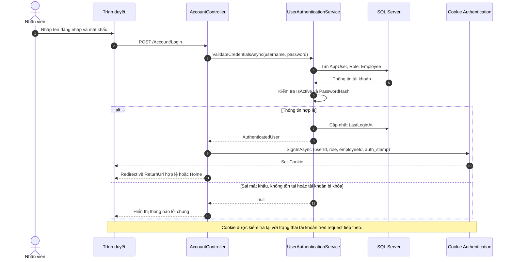
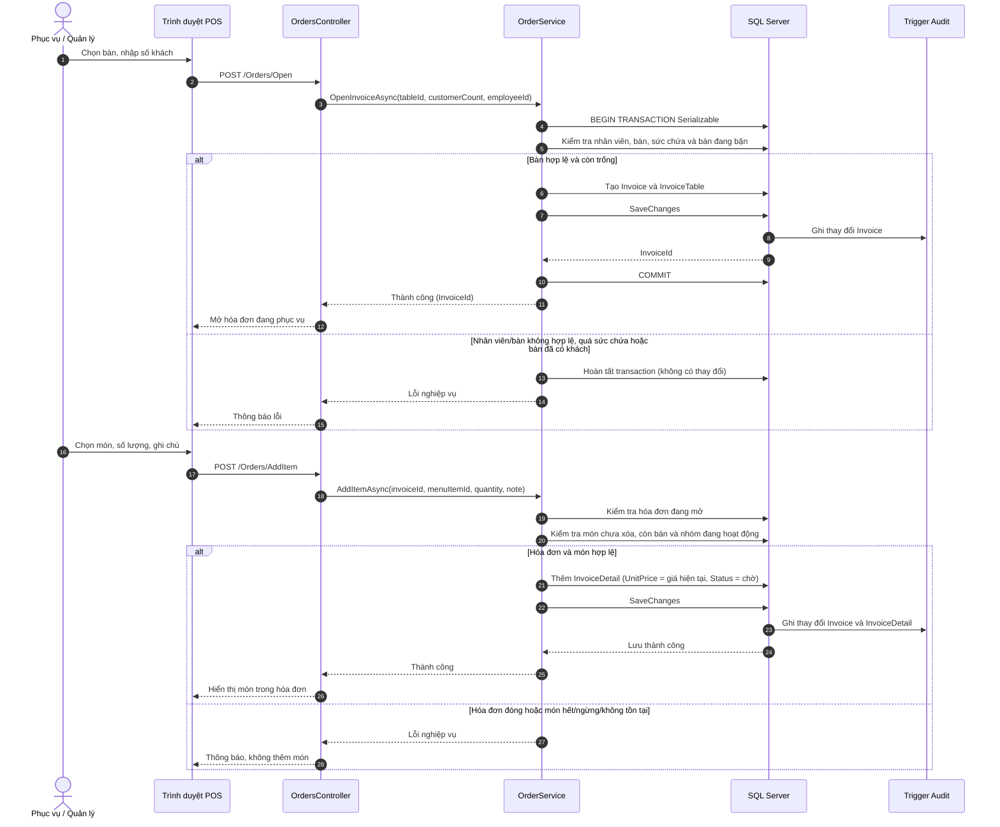
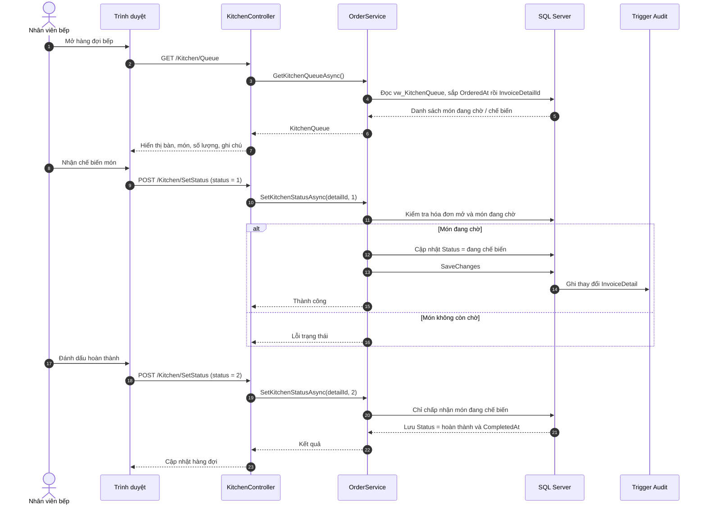
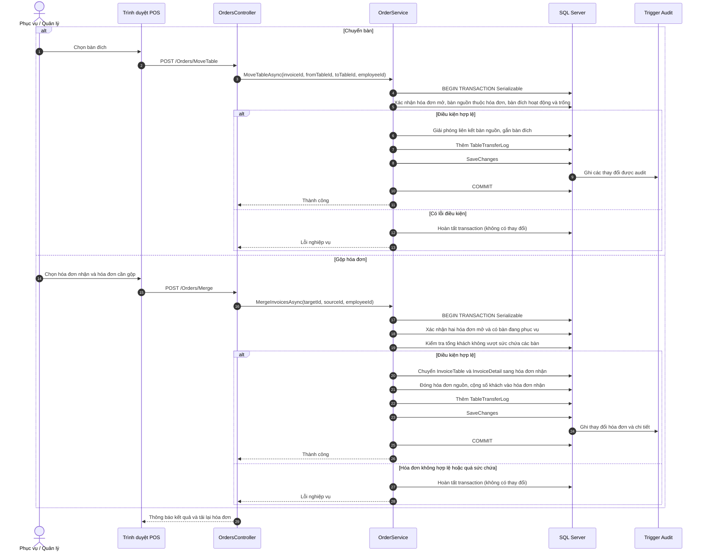
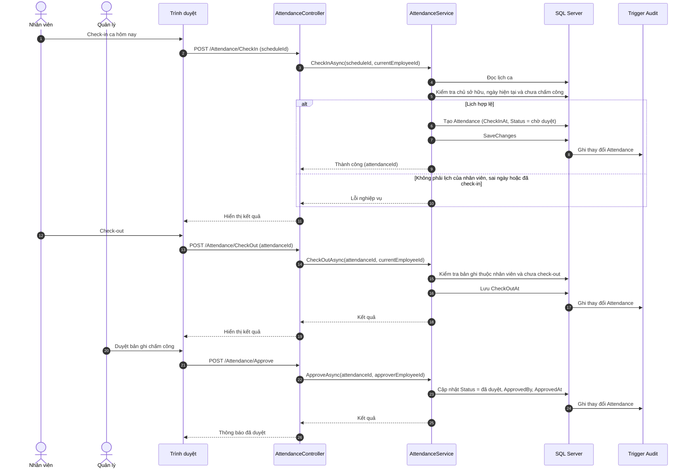

# Biểu đồ tuần tự — Hệ thống quản lý quán ăn

Tài liệu mô tả các luồng tương tác chính giữa người dùng, giao diện MVC, controller, service và SQL Server. Các biểu đồ được viết bằng Mermaid; có thể xem trực tiếp trên GitHub hoặc trong trình soạn thảo hỗ trợ Mermaid.

## 1. Đăng nhập

Luồng đăng nhập xác thực tài khoản hoạt động, kiểm tra mật khẩu hash, sau đó tạo cookie chứa các claim cần thiết. Những request đã đăng nhập tiếp tục được kiểm tra trạng thái tài khoản để vô hiệu hóa phiên nếu tài khoản bị khóa, đổi vai trò hoặc nhân viên nghỉ việc.



## 2. Mở bàn và gọi món

Mở bàn kiểm tra nhân viên, trạng thái bàn, số ghế và hóa đơn đang hoạt động trong transaction `Serializable`. Mỗi lần gọi món tạo một dòng chi tiết mới, chụp giá hiện tại vào hóa đơn và xếp món vào hàng đợi bếp.



## 3. Bếp nhận và hoàn thành món

Hàng đợi lấy các món đang phục vụ từ view `vw_KitchenQueue`, theo thứ tự thời gian đặt (FIFO). Trạng thái chỉ chuyển theo thứ tự `Chờ → Đang chế biến → Hoàn thành`.



## 4. Chuyển bàn và gộp hóa đơn

Hai thao tác được thực hiện trong transaction `Serializable`. Chuyển bàn yêu cầu bàn đích trống. Gộp hóa đơn chuyển các bàn và chi tiết món sang hóa đơn nhận, ghi lịch sử chuyển/gộp và kiểm tra sức chứa cộng dồn.



## 5. Thanh toán và tạo biên nhận

Hệ thống tính tổng từ chi tiết món chưa hủy; giảm giá chỉ dành cho MANAGER và không vượt tiền món. Nếu còn món chưa hoàn thành, người dùng phải xác nhận. Việc đóng hóa đơn, ghi thanh toán và giải phóng bàn nằm trong cùng transaction `Serializable`.

```mermaid
sequenceDiagram
    autonumber
    actor Cashier as Thu ngân / Quản lý
    participant Browser as Trình duyệt
    participant Controller as PaymentsController
    participant Service as PaymentService
    participant DB as SQL Server
    participant Audit as Trigger Audit

    Cashier->>Browser: Chọn hóa đơn cần thanh toán
    Browser->>Controller: GET /Payments/Checkout
    Controller->>Service: GetCheckoutAsync(invoiceId)
    Service->>DB: Đọc hóa đơn mở, chi tiết món và các bàn
    DB-->>Service: Tạm tính, món chưa hoàn thành
    Service-->>Controller: Checkout
    Controller-->>Browser: Hiển thị tổng tiền, giảm giá và phương thức

    Cashier->>Browser: Xác nhận thanh toán
    Browser->>Controller: POST /Payments/Pay
    Controller->>Service: PayAsync(invoiceId, method, discount, confirmation, employeeId)
    Service->>DB: BEGIN TRANSACTION Serializable
    Service->>DB: Kiểm tra nhân viên, hóa đơn mở và chưa thanh toán
    Service->>DB: Tính tổng món chưa hủy; xác thực giảm giá
    alt Còn món chưa hoàn thành và chưa xác nhận
        Service->>DB: Hoàn tất transaction (không có thay đổi)
        Service-->>Controller: Yêu cầu xác nhận
    else Dữ liệu hợp lệ
        Service->>DB: Ghi DiscountAmount, đóng Invoice, giải phóng các bàn
        Service->>DB: Thêm Payment (tổng sau giảm giá)
        Service->>DB: SaveChanges
        DB->>Audit: Ghi thay đổi Invoice và Payment
        Service->>DB: COMMIT
        Service-->>Controller: Thành công (invoiceId)
        Controller-->>Browser: Redirect đến Receipt
        Browser->>Controller: GET /Payments/Receipt
        Controller->>Service: GetReceiptAsync(invoiceId)
        Service->>DB: Đọc hóa đơn đã thanh toán và Payment
        DB-->>Service: Dữ liệu biên nhận
        Service-->>Controller: Receipt
        Controller-->>Browser: Hiển thị biên nhận để in
    else Hóa đơn không hợp lệ, giảm giá sai hoặc không còn bàn
        Service->>DB: Hoàn tất transaction (không có thay đổi)
        Service-->>Controller: Lỗi nghiệp vụ
        Controller-->>Browser: Thông báo lỗi thanh toán
    end
```

## 6. Chấm công và duyệt công

Nhân viên chỉ check-in lịch ca của chính mình trong ngày hiện tại; check-out gắn vào bản ghi đã tạo. Quản lý duyệt bản ghi để xác nhận công; báo cáo lương chỉ sử dụng công đã duyệt.



## Ghi chú thiết kế

- Các sơ đồ mô tả luồng chính, không bao gồm mọi nhánh lỗi hoặc toàn bộ thao tác quản trị CRUD.
- Controller chịu trách nhiệm nhận request, kiểm tra quyền/ModelState và gọi service; quy tắc nghiệp vụ nằm trong service, dữ liệu được lưu qua EF Core.
- Các thao tác ghi lên bảng có trigger audit đặt `ChangedByUserId` qua `sys.sp_set_session_context` ngay trong lần `SaveChanges`; trigger SQL Server ghi nội dung thay đổi vào `AuditLog`.
- Thời điểm ghi trong database dùng UTC; các trang nghiệp vụ hiển thị giờ Việt Nam.
- Những thao tác có tính cạnh tranh bàn/hóa đơn sử dụng transaction; mở bàn, chuyển bàn, gộp hóa đơn và thanh toán dùng `Serializable`.
- Nếu service trả lỗi nghiệp vụ trước khi ghi, transaction hoàn tất mà không có thay đổi dữ liệu.

## Tài liệu liên quan

- Ca sử dụng: `04_UseCases.md`
- Yêu cầu nghiệp vụ: `02_BusinessRequirements.md`
- Thiết kế database: `11_DatabaseSchemaDesign.md`
- Cài đặt và chạy ứng dụng: `../README.md`
